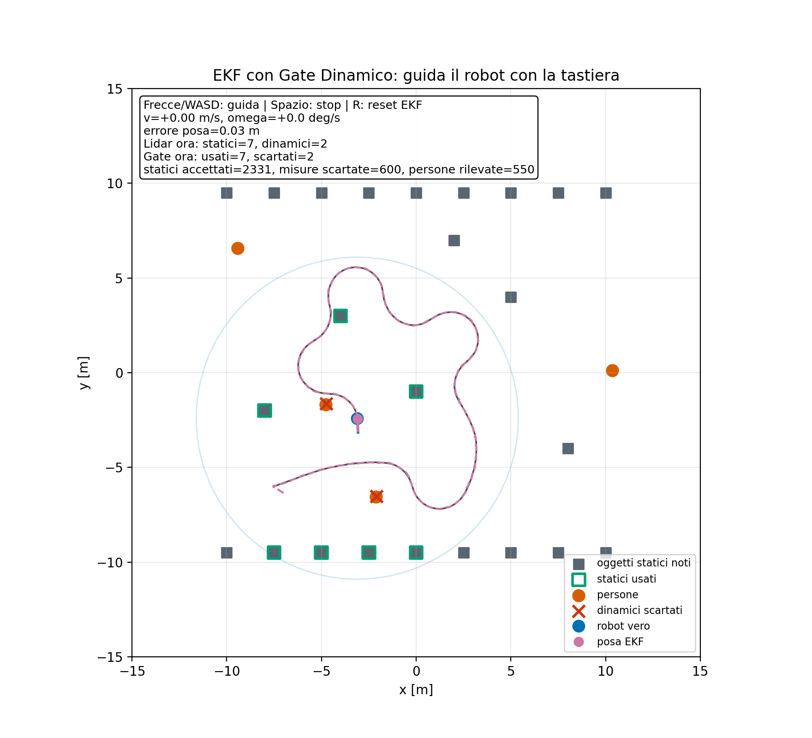

```{python}
#| label: preparazione-dati
from pathlib import Path
import ast
import copy
import json
import numpy as np
import pandas as pd
import matplotlib.pyplot as plt

ROOT = Path.cwd()
ARTIFACTS = ROOT / "artifacts"
# Lasciare None per selezionare il CSV con timestamp più recente nel nome.
# Per una sessione specifica, inserire qui il nome completo del CSV.
SESSION_CSV = None
files = sorted(ARTIFACTS.glob("lidar_dynamic_gate_log_*.csv"))
if SESSION_CSV is None:
    if not files:
        raise FileNotFoundError("Nessun log di simulazione trovato in artifacts.")
    csv_path = files[-1]
else:
    csv_path = ARTIFACTS / SESSION_CSV

df = pd.read_csv(csv_path)
required = ["frame", "time_s", "true_x_m", "true_y_m", "estimated_x_m",
            "estimated_y_m", "position_error_m", "heading_error_deg",
            "visible_static_count", "visible_dynamic_count", "accepted_count",
            "rejected_count", "rejected_person_count"]
missing = set(required) - set(df.columns)
if missing or len(df) < 2:
    raise ValueError(f"Log non valido: colonne mancanti {missing}, campioni {len(df)}")
if df[required].isna().any().any():
    raise ValueError("Il log contiene valori mancanti.")
if not np.all(np.diff(df["time_s"]) > 0):
    raise ValueError("I tempi del log devono essere strettamente crescenti.")
last = df.iloc[-1]
n = len(df)
duration = float(last["time_s"] - df["time_s"].iloc[0])
dt = float(np.median(np.diff(df["time_s"])))
e = df["position_error_m"].to_numpy()
a = df["heading_error_deg"].to_numpy()
rmse = float(np.sqrt(np.mean(e**2)))
mean_error = float(np.mean(e))
max_error = float(np.max(e))
final_error = float(e[-1])
heading_rmse = float(np.sqrt(np.mean(a**2)))
initial_error = float(e[0])
post_rmse = float(np.sqrt(np.mean(e[1:]**2)))
post_max = float(np.max(e[1:]))
static_total = int(df["visible_static_count"].sum())
dynamic_total = int(df["visible_dynamic_count"].sum())
accepted = int(last["accepted_count"])
rejected = int(last["rejected_count"])
dynamic_rejected = int(last["rejected_person_count"])
dynamic_accepted = dynamic_total - dynamic_rejected
static_rejected = rejected - dynamic_rejected
static_accepted = static_total - static_rejected
if min(dynamic_accepted, dynamic_rejected, static_accepted, static_rejected) < 0:
    raise ValueError("Conteggi di classificazione incoerenti.")
if accepted != static_accepted + dynamic_accepted:
    raise ValueError("Misure generate e contatori cumulativi non coincidono.")
if accepted + rejected != static_total + dynamic_total:
    raise ValueError("Numero complessivo di decisioni non coerente.")

def fmt(value, digits=4):
    return f"{value:.{digits}f}".replace(".", ",")

def percent(num, den):
    return "non definita (denominatore nullo)" if den == 0 else fmt(100*num/den, 2) + "%"

# Il JSON deve appartenere alla medesima sessione del CSV.
suffix = csv_path.name.removeprefix("lidar_dynamic_gate_log_").removesuffix(".csv")
summary_path = ARTIFACTS / f"lidar_dynamic_gate_summary_{suffix}.json"
summary = json.loads(summary_path.read_text(encoding="utf-8")) if summary_path.exists() else {}
if summary and int(summary["samples_including_initial_pose"]) != n:
    raise ValueError("CSV e riepilogo JSON hanno un numero di campioni differente.")
seed_text = str(summary.get("seed", "non registrato"))

# Lettura statica dello script: non avvia la GUI e non esegue la simulazione.
source_path = ROOT / "interactive_lidar_dynamic_gate.py"
source = source_path.read_text(encoding="utf-8")
tree = ast.parse(source)

def find_node(name, owner=None):
    nodes = tree.body if owner is None else next(
        x for x in tree.body if isinstance(x, ast.ClassDef) and x.name == owner).body
    return next(x for x in nodes if isinstance(x, (ast.FunctionDef, ast.ClassDef)) and x.name == name)

def show_code(name, owner=None):
    node = copy.deepcopy(find_node(name, owner))
    # Rimuove anche eventuali stringhe-commento interne, senza cambiare le istruzioni.
    class RemoveStringComments(ast.NodeTransformer):
        def visit_Expr(self, item):
            if isinstance(item.value, ast.Constant) and isinstance(item.value.value, str):
                return None
            return self.generic_visit(item)
    node = RemoveStringComments().visit(node)
    print("```python\n" + ast.unparse(node) + "\n```\n")

precision_text = percent(dynamic_rejected, rejected)
recall_text = percent(dynamic_rejected, dynamic_total)
static_reject_text = percent(static_rejected, static_total)
```

# Obiettivo e impostazione del progetto

Il progetto realizza una simulazione interattiva di localizzazione di un robot in una mappa nota contenente landmark statici e persone mobili. Il robot viene guidato mediante tastiera; un Extended Kalman Filter (EKF) ne stima la posizione e l’orientamento utilizzando odometria rumorosa e misure Lidar simulate di distanza e angolo.

Per evitare che osservazioni di persone mobili producano correzioni errate, ogni misura viene confrontata con la mappa statica. Un controllo geometrico e un gate adattativo sull’innovazione determinano se utilizzarla nell’EKF oppure scartarla. Una misura rifiutata è incompatibile con la mappa: questo non costituisce, da solo, una prova del movimento dell’oggetto.

La valutazione riguarda il comportamento del sistema con gate dinamico durante una sessione manuale, senza confronti con altre strategie.

# Ambiente e sensore simulati

## Mappa statica e persone mobili

La mappa contiene punti di riferimento noti disposti lungo due file orizzontali e in posizioni isolate. La disposizione effettivamente implementata è riportata nell’appendice, estratta automaticamente dalla funzione `_make_static_objects` dello script.

Le posizioni delle persone sono inizializzate con distribuzione uniforme nell’intervallo $[-0.65W,0.65W]$ lungo ciascun asse, dove $W$ è la semi-estensione del mondo. Le due componenti della velocità iniziale sono estratte indipendentemente da una distribuzione normale. Il secondo argomento di `rng.normal` rappresenta la deviazione standard, non la varianza; i valori utilizzati sono consultabili nell’estratto di inizializzazione in appendice.

A ogni passo si applica:

$$
p_{k+1}=p_k+v_k\Delta t.
$$

Al superamento dei limiti $[-0.8W,0.8W]$ viene invertita la componente della velocità relativa all’asse interessato; la posizione viene ricondotta entro il limite tramite clipping.

## Misure Lidar

Il sensore è modellato a livello di oggetti puntiformi: produce misure rumorose per i punti entro la portata, senza simulare una scansione laser completa, la segmentazione o le occlusioni. Per un landmark $l=(l_x,l_y)^T$ e una posa $x=(x,y,\theta)^T$:

$$
\begin{aligned}
\Delta_x &= l_x-x, & \Delta_y &= l_y-y,\\
r &= \sqrt{\Delta_x^2+\Delta_y^2}, &
\beta &= \operatorname{wrap}\bigl(\operatorname{atan2}(\Delta_y,\Delta_x)-\theta\bigr).
\end{aligned}
$$

Il vettore di misura è $z=(r,\beta)^T$. Alla distanza e all’angolo si aggiungono rumori gaussiani indipendenti, con covarianza:

$$
R=\operatorname{diag}(\sigma_r^2,\sigma_\beta^2).
$$

La funzione `wrap_angle` riporta gli angoli nell’intervallo $[-\pi,\pi)$.

# Modello del robot e filtro EKF

## Stato e modello cinematico

Lo stato stimato è $x_k=(x_k,y_k,\theta_k)^T$. Il modello uniciclo discretizzato è:

$$
\begin{aligned}
x_{k+1}&=x_k+v_k\cos(\theta_k)\Delta t,\\
y_{k+1}&=y_k+v_k\sin(\theta_k)\Delta t,\\
\theta_{k+1}&=\operatorname{wrap}(\theta_k+\omega_k\Delta t).
\end{aligned}
$$

Il moto reale utilizza i comandi impartiti dalla tastiera; all’EKF vengono forniti comandi perturbati da rumore per rappresentare errori di odometria. La posizione reale viene inoltre limitata ai confini del mondo simulato tramite clipping.

Il filtro è inizializzato con uno scostamento intenzionale dalla posa reale e con una covarianza diagonale. Le condizioni iniziali della sessione analizzata sono ricavate dal primo campione del log, non assunte uguali a quelle di altre prove.

## Predizione

La predizione della posa segue il modello cinematico. La covarianza viene propagata mediante:

$$
P_{k+1}^-=F_kP_k^+F_k^T+Q,
$$

con:

$$
F_k=\begin{pmatrix}
1&0&-v_k\sin(\theta_k)\Delta t\\
0&1&v_k\cos(\theta_k)\Delta t\\
0&0&1
\end{pmatrix},
\qquad
Q=\operatorname{diag}(\sigma_{xy}^2,\sigma_{xy}^2,\sigma_\theta^2).
$$

$Q$ rappresenta la covarianza del rumore di processo per passo, adottata nell’implementazione; non coincide con il rumore casuale aggiunto ai comandi.

## Modello di osservazione e correzione

Il modello $h(x,l)$ restituisce distanza e angolo previsti. Per $q=\Delta_x^2+\Delta_y^2$ e $r=\sqrt q$, il suo Jacobiano rispetto alla posa è:

$$
H=\begin{pmatrix}
-\Delta_x/r&-\Delta_y/r&0\\
\Delta_y/q&-\Delta_x/q&-1
\end{pmatrix}.
$$

Nel codice si impone un piccolo limite inferiore a $q$ per evitare divisioni per zero. Per una misura accettata, indicando con $-$ e $+$ le quantità prima e dopo la correzione:

$$
\begin{aligned}
\nu_k&=z_k-h(\hat{x}_k^-),\\
S_k&=H_kP_k^-H_k^T+R,\\
K_k&=P_k^-H_k^TS_k^{-1},\\
\hat{x}_k^+&=\hat{x}_k^-+K_k\nu_k.
\end{aligned}
$$

La componente angolare dell’innovazione e l’orientamento corretto vengono normalizzati. La covarianza viene aggiornata con la forma di Joseph:

$$
P_k^+=(I-K_kH_k)P_k^-(I-K_kH_k)^T+K_kRK_k^T.
$$

Questa formulazione favorisce la stabilità numerica. $S_k$ è la covarianza dell’innovazione e $K_k$ il guadagno di Kalman. Le misure accettate vengono elaborate sequenzialmente.

# Associazione delle misure e gate dinamico

## Controllo geometrico

La misura viene convertita nel riferimento locale del robot:

$$
p_{\mathrm{obs}}=\begin{pmatrix}r\cos\beta\\r\sin\beta\end{pmatrix}.
$$

Per ciascun landmark si predice la posizione relativa:

$$
p_{\mathrm{exp},i}=R(\hat\theta^-)^T(l_i-\hat p^-),\qquad
R(\theta)^T=\begin{pmatrix}\cos\theta&\sin\theta\\-\sin\theta&\cos\theta\end{pmatrix}.
$$

Il candidato è quello che minimizza $e_{\mathrm{rel},i}=\|p_{\mathrm{obs}}-p_{\mathrm{exp},i}\|$. Il controllo geometrico richiede che tale errore sia inferiore a `association_gate`.

## Controllo sull’innovazione

Per il candidato selezionato si verifica anche:

$$
d^2=\nu^TS^{-1}\nu<g_{\mathrm{dyn}}.
$$

La soglia adattativa è:

$$
g_{\mathrm{dyn}}=\operatorname{clip}\left(
 g_0+c_u\sqrt{\max(\det S,0)}+c_v|\tilde v|-c_rr,
 g_{\min},g_{\max}\right),
$$

dove $\tilde v$ è il comando lineare rumoroso fornito al filtro. I parametri effettivi sono quelli della funzione e della configurazione riportate in appendice. A parità degli altri termini, l’incertezza e la velocità ampliano la soglia, mentre la distanza la restringe, entro i limiti del clipping. La soglia è euristica: l’adattamento non corrisponde a un livello di confidenza statistico costante.

La misura viene accettata soltanto se supera entrambi i controlli. Il termine “dinamico” riferito al gate indica che la soglia si adatta alle condizioni operative; il metodo non stima esplicitamente la velocità di ciascun oggetto.

L’associazione geometrica utilizza la posa predetta all’inizio del fotogramma. Le distanze di innovazione e le relative covarianze sono invece calcolate con lo stato corrente dell’EKF, che può includere aggiornamenti dovuti a misure già accettate nello stesso fotogramma.

L’etichetta `source`, nota al simulatore, serve esclusivamente a valutare i rifiuti e aggiornare i contatori. Non viene utilizzata per decidere l’accettazione della misura.

# Sessione analizzata e risultati

## Provenienza dei dati e riproducibilità

Il report seleziona automaticamente il CSV con timestamp più recente nel nome tra quelli presenti in `artifacts`. Per scegliere una sessione specifica si può impostare `SESSION_CSV` nel primo blocco Python del QMD. Tutti gli indicatori seguenti vengono ricalcolati dal CSV; l’eventuale JSON viene letto soltanto se ha lo stesso identificativo di sessione.

**Log analizzato:** `{python} csv_path.name`.

| Parametro della registrazione | Valore |
|:--|--:|
| Tempo simulato [s] | `{python} fmt(duration, 2)` |
| Passo temporale [s] | `{python} fmt(dt, 2)` |
| Campioni, inclusa la posa iniziale | `{python} n` |
| Seed registrato nel riepilogo | `{python} seed_text` |

La guida è manuale: il seed non rende riproducibile da solo la sequenza di comandi. Il log non registra gli eventi di reset del filtro; se è stato usato il tasto `R`, le metriche includono i campioni prima e dopo il reset. Per una prova senza interventi sulla stima occorre evitare tale comando.

## Localizzazione

L’errore di posizione e il relativo RMSE sono definiti come:

$$
e_k=\sqrt{(\hat x_k-x_k)^2+(\hat y_k-y_k)^2},\qquad
\mathrm{RMSE}_{\mathrm{pos}}=\sqrt{\frac1N\sum_{k=1}^N e_k^2}.
$$

L’errore angolare è normalizzato in $[-\pi,\pi)$ e convertito in gradi per la presentazione.

| Indicatore | Valore |
|:--|--:|
| Errore iniziale di posizione [m] | `{python} fmt(initial_error)` |
| RMSE di posizione, tutti i campioni [m] | `{python} fmt(rmse)` |
| Errore medio di posizione [m] | `{python} fmt(mean_error)` |
| Errore massimo di posizione [m] | `{python} fmt(max_error)` |
| Errore finale di posizione [m] | `{python} fmt(final_error)` |
| RMSE di orientamento [gradi] | `{python} fmt(heading_rmse, 3)` |
| RMSE di posizione senza il campione iniziale [m] | `{python} fmt(post_rmse)` |
| Errore massimo senza il campione iniziale [m] | `{python} fmt(post_max)` |

: Errori calcolati dalla sessione selezionata. {#tbl-errori}

Gli indicatori principali includono lo scostamento iniziale imposto al filtro. Gli ultimi due indicatori escludono soltanto il primo campione: non rappresentano una selezione automatica del regime stazionario.

```{python}
#| label: fig-errori
#| fig-cap: "Errori di posizione e orientamento durante la sessione selezionata."
#| fig-width: 7
#| fig-height: 4.4
#| fig-pos: "htbp"
plt.rcParams.update({"font.size": 10})
fig, axes = plt.subplots(2, 1, sharex=True, figsize=(7, 4.4), layout="constrained")
axes[0].plot(df["time_s"], e, color="#0072B2", linewidth=1.2)
axes[0].set_ylabel("Errore di posizione [m]")
axes[1].plot(df["time_s"], a, color="#D55E00", linewidth=1.2)
axes[1].set_ylabel("Errore angolare [gradi]")
axes[1].set_xlabel("Tempo simulato [s]")
for ax in axes:
    ax.grid(alpha=0.25)
plt.show()
```

```{python}
#| label: fig-traiettoria
#| fig-cap: "Confronto tra traiettoria reale e stimata, ricostruite dal CSV."
#| fig-width: 6
#| fig-height: 4.5
#| fig-pos: "htbp"
fig, ax = plt.subplots(figsize=(6, 4.5), layout="constrained")
ax.plot(df["true_x_m"], df["true_y_m"], color="#0072B2", label="Traiettoria reale")
ax.plot(df["estimated_x_m"], df["estimated_y_m"], "--", color="#CC79A7", label="Traiettoria EKF")
ax.scatter(df["true_x_m"].iloc[0], df["true_y_m"].iloc[0], marker="o", color="black", label="Partenza", zorder=3)
ax.set(xlabel="x [m]", ylabel="y [m]")
ax.set_aspect("equal", adjustable="datalim")
ax.grid(alpha=0.25)
ax.legend(fontsize=9)
plt.show()
```

## Classificazione delle misure

La provenienza reale delle misure è nota nel simulatore. Le misure generate sono sommate sui fotogrammi; i contatori cumulativi di accettazione e rifiuto vengono invece letti esclusivamente nell’ultima riga, per evitare conteggi ripetuti.

| Provenienza | Accettata | Scartata | Totale |
|:--|--:|--:|--:|
| Landmark statici | `{python} static_accepted` | `{python} static_rejected` | `{python} static_total` |
| Persone mobili | `{python} dynamic_accepted` | `{python} dynamic_rejected` | `{python} dynamic_total` |
| **Totale** | **`{python} accepted`** | **`{python} rejected`** | **`{python} accepted + rejected`** |

: Decisioni del sistema distinte per provenienza reale della misura. {#tbl-classificazione}

I conteggi riguardano misure, non oggetti distinti: la stessa persona o lo stesso landmark può essere osservato ripetutamente. “Accettata” significa ritenuta compatibile con la mappa, non necessariamente proveniente da un oggetto realmente statico.

| Indicatore | Definizione | Valore |
|:--|:--|--:|
| Rifiuto delle misure dinamiche (recall) | Dinamiche scartate / dinamiche generate | `{python} recall_text` |
| Precisione degli scarti | Dinamiche scartate / tutte le scartate | `{python} precision_text` |
| Rifiuto delle misure statiche | Statiche scartate / statiche generate | `{python} static_reject_text` |

```{python}
#| output: asis
if dynamic_total == 0:
    print("Nella sessione non sono state generate misure di persone: non è possibile valutare il rifiuto delle misure dinamiche.")
else:
    print(f"Delle {dynamic_total} misure provenienti da persone mobili, {dynamic_rejected} sono state scartate e {dynamic_accepted} sono state accettate nell’EKF. La percentuale di rifiuto delle misure dinamiche è {recall_text}.")
print(f"\nDelle {static_total} misure statiche, {static_rejected} sono state scartate. Questo conteggio quantifica il costo del filtraggio in termini di osservazioni statiche non utilizzate.")
```

## Interfaccia interattiva

I quadrati grigi rappresentano i landmark noti; i contorni verdi indicano i landmark associati alle misure accettate. Le persone sono arancioni, le misure rifiutate sono croci rosse, il robot reale è blu e la stima EKF è rosa. I comandi sono frecce o `WASD` per la guida, spazio per fermarsi, `R` per reimpostare la stima ed `Esc` per salvare uno screenshot e chiudere la finestra.

```{python}
#| output: asis
screenshot = ARTIFACTS / "lidar_dynamic_gate_screenshot.png"
if screenshot.exists():
    print('{width=90%}')
```

Lo screenshot ha un nome fisso e non contiene l’identificativo della sessione nel nome: non se ne assume quindi la corrispondenza con il CSV selezionato. I risultati quantitativi e le traiettorie precedenti dipendono esclusivamente dal log analizzato.

# Discussione e conclusioni

```{python}
#| output: asis
print(f"La sessione analizzata presenta un RMSE di posizione pari a {fmt(rmse)} m e un errore finale pari a {fmt(final_error)} m. Sono state utilizzate {accepted} misure e scartate {rejected} misure.")
if dynamic_total > 0:
    if dynamic_accepted == 0:
        print("\nIn questa prova tutte le misure delle persone sono state escluse dall’aggiornamento dell’EKF.")
    else:
        print(f"\nIn questa prova {dynamic_accepted} misure delle persone sono state utilizzate nell’EKF: il rifiuto degli oggetti dinamici non è stato completo.")
print(f"\nIl rifiuto delle misure statiche è pari a {static_reject_text}. Il risultato deve essere interpretato insieme alla capacità di rifiutare le osservazioni dinamiche, poiché un filtro troppo restrittivo può eliminare anche informazioni utili alla localizzazione.")
```

La valutazione documenta il comportamento di una singola sessione simulata; non dimostra superiorità rispetto ad altri metodi né garantisce le stesse prestazioni in qualsiasi ambiente. I principali limiti sono la semplicità del modello del sensore e delle persone, la disponibilità di una mappa nota e la scelta euristica delle soglie.

La posa vera permette di misurare direttamente l’errore: su un robot reale sarebbe necessario un riferimento indipendente. Il progetto mostra l’integrazione di associazione geometrica, gate adattativo ed EKF in un’interfaccia guidabile, con risultati verificabili tramite log.

# Estratti dell’implementazione {.appendix}

I frammenti seguenti vengono generati dal file `interactive_lidar_dynamic_gate.py` presente al momento del render. La logica è quella dello script; commenti e docstring vengono rimossi e la formattazione viene normalizzata. Il file di simulazione non viene eseguito per produrre questi estratti.

Il log attuale non conserva una copia completa della configurazione o del codice della sessione: questi estratti documentano quindi lo script disponibile, non certificano che una vecchia registrazione sia stata prodotta dalla medesima versione. Dopo modifiche al modello o ai parametri è opportuno registrare una nuova sessione.

## Configurazione

```{python}
#| output: asis
show_code("ExperimentConfig")
show_code("InteractiveConfig")
```

## Costruzione della mappa e inizializzazione

```{python}
#| output: asis
show_code("_make_static_objects", "InteractiveLidarSimulation")
node = find_node("__init__", "InteractiveLidarSimulation")
wanted = {"robot", "people", "people_vel", "ekf"}
print("```python")
for statement in node.body:
    if isinstance(statement, ast.Assign) and any(isinstance(t, ast.Attribute) and t.attr in wanted for t in statement.targets):
        print(ast.unparse(statement))
print("```\n")
```

## Modello cinematico e movimento delle persone

```{python}
#| output: asis
show_code("step_unicycle")
show_code("_move_people", "InteractiveLidarSimulation")
```

## Misure e trasformazioni

```{python}
#| output: asis
show_code("relative_xy")
show_code("relative_to_measurement")
show_code("measurement_to_relative")
show_code("measurement_model", "PoseEKF")
```

## Predizione e aggiornamento EKF

```{python}
#| output: asis
show_code("predict", "PoseEKF")
show_code("innovation_distance", "PoseEKF")
show_code("update", "PoseEKF")
```

## Associazione e soglia adattativa

```{python}
#| output: asis
show_code("_classify_and_update", "InteractiveLidarSimulation")
show_code("_dynamic_motion_gate", "InteractiveLidarSimulation")
```